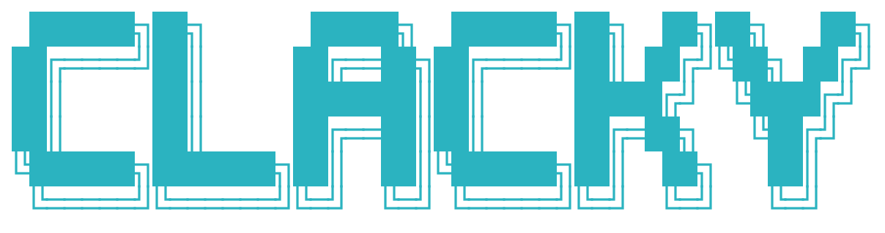

<h1 align="center"></h1>

<p align="center"><a href="#install">Install</a> · <a href="https://docs.rs/clacky">Docs</a> · <a href="examples">Examples</a></p>

<div align="center">

[](https://crates.io/crates/clacky)
[](https://docs.rs/clacky)
[](https://github.com/easymikey/clacky/actions/workflows/ci.yml)
[](Cargo.toml)
[](#license)

</div>

Clack-style prompts for Rust: one question at a time on a rail, answers as typed values, and a form you can test without a terminal. It is a port of [@clack/prompts](https://github.com/bombshell-dev/clack) with its look and keys.

```text
┌   create-app
│
◇  Where should we create your project?
│  ./sparkling-solid
│
◆  Pick a project type
│  ● TypeScript
│  ○ JavaScript
└
```

## Why

clacky is inspired by [clack](https://github.com/bombshell-dev/clack) 🍦: the prettiest terminal prompts I know, and I wanted them in Rust. [cliclack](https://github.com/fadeevab/cliclack) ports the look but keeps the theme in a global, so you can't change colors per session or test your prompts. clacky keeps clack's look and makes everything a value: the prompts, the theme, the texts. It pulls in 4 crates where cliclack pulls in 41.

## Features

- **Prompts**: `text`, `password`, `confirm`, `number`, `date`, `path`, `select`, `multiselect`, `autocomplete` and more, each a builder.
- **Derive forms**: `#[derive(Choices, Form)]` makes an enum a `select` and a struct a form.
- **Live output**: spinner, progress bar, tasks, notes and boxes.
- **Theming by value**: theme, symbols, messages and keys belong to the session, not a global.
- **Prefill and `--yes`**: `.given(arg)` skips an answered question, `Defaults::Take` takes the defaults.
- **Terminals without a keyboard**: `TERM=dumb` and piped input have their own path.
- **Abort and timeout**: `.timeout(duration)` and `Abort` end a question and restore the terminal.
- **Scripted tests**: `Prompt::simulate` and `fake::Script` run a form without a terminal.
- **Small**: 4 dependencies, async included, about 410 KiB for a three question form.

## Install

```sh
cargo add clacky
cargo add clacky --features derive      # #[derive(Choices, Form)]
cargo add clacky --dev --features fake  # the scripted terminal, in tests
```

The async API (`ask_until`, `wait`, `async_tasks`) works on any executor. The minimum Rust version is 1.85.

## Quick start

```rust,no_run
use clacky::prelude::*;

fn main() -> Result<()> {
    let ui = Session::detect()?;
    ui.intro("my-app")?;

    let name = ui.ask(text("Project name").placeholder("my-app").default("my-app"))?;
    let kind = ui.ask(select("Kind").item("lib", "Library").item("bin", "Binary"))?;
    let port: u16 = ui.ask(number("Port").min(1).max(65535).default(8080))?;

    if ui.ask(confirm("Create it?"))? {
        ui.outro(format!("{name}: {kind} on {port}"))
    } else {
        ui.cancel("Nothing created")
    }
}
```

The same, with a No that ends the form: `ui.ask(confirm("Create it?").or_cancel("Nothing created"))?;`. Text arguments of `intro`, `outro`, `cancel`, `log` and the spinner take anything that is `Display`, so `format_args!(..)` works too.

`Session::detect` reads the environment once. Esc and Ctrl-C come back as errors. The [guide](https://docs.rs/clacky/latest/clacky/guide/index.html) has a page per topic.

## Examples

Run one with `cargo run --example <name>` (`derive` needs `--features derive`): [`create_app`](examples/create_app.rs), [`select`](examples/select.rs), [`search`](examples/search.rs), [`files_and_dates`](examples/files_and_dates.rs), [`numbers`](examples/numbers.rs), [`live`](examples/live.rs), [`abort`](examples/abort.rs), [`defaults`](examples/defaults.rs), [`i18n`](examples/i18n.rs), [`accessible`](examples/accessible.rs), [`derive`](examples/derive.rs), [`login`](examples/login.rs) and [`size`](examples/size.rs).

## Contributing

See [`CONTRIBUTING.md`](CONTRIBUTING.md).

## License

MIT or Apache-2.0, at your option.
